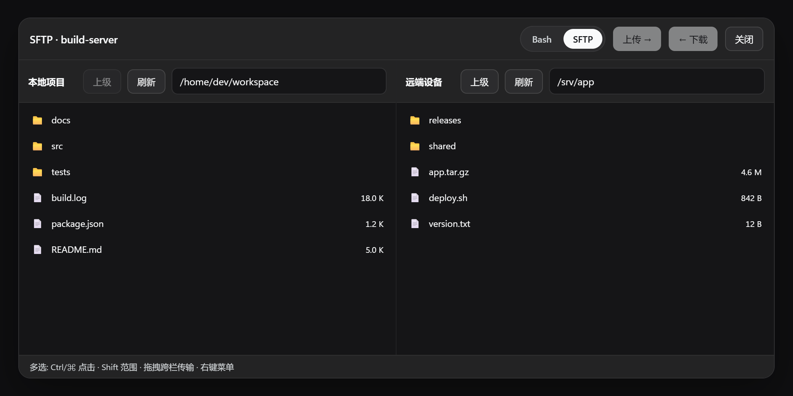
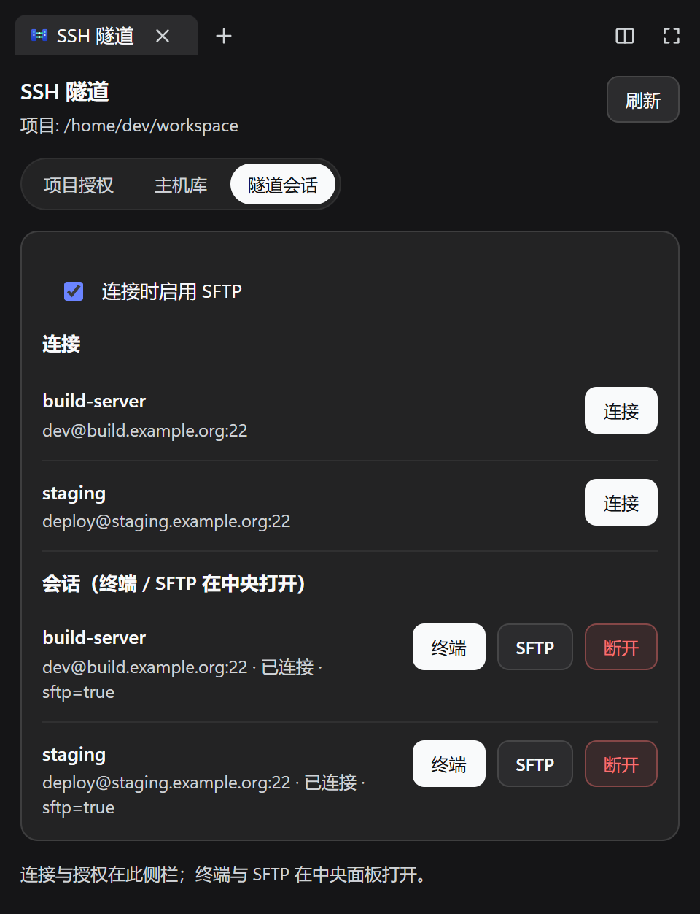

<p align="center"><strong>简体中文</strong> | <a href="README_en.md">English</a></p>

<div align="center">
<h1><br>DSH SSH Tunnel</h1>

  <p>DeepSeek Harness 的多机 SSH 工作台：主机库、按项目授权、右侧栏里的终端与双栏 SFTP。</p>
  <p>模型用 <strong>SSHManager</strong> 工具执行命令、传文件；你在侧栏管主机与授权。<strong>密钥不进模型上下文</strong>。</p>

  <p>
    <a href="https://www.npmjs.com/package/dsh-ssh-tunnel"></a>
    
    <a href="LICENSE"></a>
    <a href="https://github.com/OMSociety/dsh-ssh-tunnel/stargazers"></a>
    <a href="https://github.com/OMSociety/dsh-ssh-tunnel/issues"></a>
  </p>

<a href="#这是什么">这是什么</a> • <a href="#效果">效果</a> • <a href="#安装方式">安装方式</a> • <a href="#侧栏">侧栏</a> • <a href="#模型工具">模型工具</a> • <a href="#安全">安全</a> • <a href="#开发">开发</a> • <a href="#许可证与作者">许可证与作者</a>
</div>

## 这是什么

**DSH SSH Tunnel** 是 DeepSeek Harness 的社区插件，挂在 **DSH 官方右侧栏**的标签页上：把多台 SSH 主机收进一个**主机库**，按项目授权，然后在中央面板里开**交互式终端**（xterm）或**双栏 SFTP**。

它**不会**把全局 `fs` / `subprocess` 换成一个远程盘：远端操作只发生在你显式调用的 `SSHManager` 工具与面板里，本地文件与远端文件始终是两侧分明的东西。

## 参考来源

**产品形态与部分 UX 参考开源项目 [LiveAgent](https://github.com/thirsty5034/LiveAgent)**（多机 SSH 主机库、按项目授权、侧栏隧道管理、中央终端 / SFTP 等）。

## 效果

<table>
<tr>
<td width="66%" align="center"></td>
<td width="34%" align="center"></td>
</tr>
<tr>
<td align="center">中央面板：双栏 SFTP —— 左侧项目工作区、右侧远端，可跨栏拖拽传输</td>
<td align="center">右侧栏：隧道会话页，连接主机并在中央打开终端或 SFTP</td>
</tr>
</table>

## 安装方式

用 DSH 自带的插件安装命令，指定目标 profile：

```powershell
# 先停掉正在运行的 DSH（运行中的服务会锁住依赖，装完再起）
dsh plugin --profile <profile> add "dsh-ssh-tunnel@1.3.0"
```

> **提示**：装好后**刷新一下浏览器页面**，「SSH 隧道」入口才会出现在右侧栏——只重启宿主不够，客户端产物是页面加载时取的。

**首次使用（owner 浏览器会话）**

1. 在右侧栏「+」中打开「SSH 隧道」，到 **主机库** 添加一台主机（密码或私钥）
2. 切到 **项目授权**，给当前项目勾上这台主机并保存（**不授权连不上**，这是有意为之）
3. 回 **隧道会话** 点 Connect；首次连接会提示确认主机密钥指纹
4. 点 **终端** 得到一个交互式 shell，或点 **SFTP** 打开双栏面板
5. 让模型用 `SSHManager action=exec` 跑条命令、用 `sftp_list` 看目录、`sftp_upload` / `sftp_download` 传文件，验证整条链路

## 侧栏

侧栏只有一个 Tab，内部三页；界面随 DSH 界面语言在中文 / 英文间即时切换：

| 页面 | 作用 |
|---|---|
| **项目授权** | 当前项目允许使用的主机；授权 key 是 **DSH 会话工作区**（`projectPathKey`） |
| **主机库** | 主机增删改、OpenSSH 配置扫描导入；密码 / 私钥（含口令），密钥只存宿主侧 |
| **隧道会话** | 连接 / 断开，打开终端或 SFTP；掉线会话留墓碑，可重连（同一 id）或关闭；意外断开自动重连最多 3 次，ssh2 keepalive 30s × 3 |

## 模型工具

`SSHManager` 的动作按用途分组：

| 动作 | 作用 |
|---|---|
| `list_hosts` / `list_sessions` | 列出当前项目已授权的主机与会话 |
| `create_session` / `close_session` | 建立或关闭会话（配合 `session_strategy`） |
| `exec` | 远端执行命令（`command`、`cwd`、`timeout_ms`） |
| `sftp_list` / `sftp_stat` / `sftp_read_text` / `sftp_write_text` | 远端目录、元数据与文本读写 |
| `sftp_mkdir` / `sftp_rename` / `sftp_delete` | 远端建目录、重命名、删除 |
| `sftp_upload` / `sftp_download` | 在项目工作区与远端之间传文件 |
| `read_session` / `send_input` / `resize_session` | 交互式会话的读取、输入与窗口尺寸 |

- 会话策略：`reuse_or_create`（默认，会复活同主机已断开的会话）、`new`、`require_existing`，或显式传 `session_id`
- 超时：默认 exec 30s、SFTP 元数据 30s、SFTP 传输 120s、shell 类操作（`read_session` / `send_input` / `resize_session`）10s；`timeout_ms` 可覆盖，取值钳制在 1000–300000，整次调用另有 300s 上限
- `max_bytes` 按原始字节计，范围为 1024–1048576。exec 默认 256 KiB，stdout 和 stderr 按收到数据的顺序共用这份预算；`sftp_read_text` 默认 512 KiB，保留文件开头的字节。超过预算时，工具文本中有 `truncated: true`。
- exec 返回 `text` 和 `isError`。文本包含 stdout、stderr 和退出状态，如 `exit: 0` 或 `exit: killed by signal TERM (no exit-status)`；连接中断且没有退出状态时显示 `exit: unknown` 并提示输出可能不完整。只有明确的退出码 0 才算成功。
- `send_input` 原样发送回车、空格和多行文本。侧栏用 `shellRead` 分页读取终端输出：最多保留 512 KiB，每页最多 256 KiB。传回上页的 `since` 读下一页；`dropped: true` 表示所需记录已被淘汰，应从 `baseSeq - 1` 重读。
- 认证方式只有**密码**或**私钥**；键盘交互式认证（含堡垒机网页 MFA）不支持

## 安全

**谁可以管理**：在 DSH 0.2.3-alpha.2，侧栏 HTTP 路由要求宿主验证的 owner 身份。主机库与信任库由 owner 管理；侧栏操作按其请求指定的项目处理。模型工具则从宿主会话取得项目，不能通过工具参数切换授权范围。

**DSH 0.2.2-rc.5 专属适配**：健康检查与静态终端资源使用宿主请求准入。侧栏管理（包括确认主机指纹）另要求宿主识别出本机浏览器的 owner 身份；仅通过会话认证或持有 API 凭据不足以管理。两个版本上的 `SSHManager` 均使用当前项目授权。清单用 `engines.dsh: "*"` 允许安装。离线准入测试覆盖上述两个宿主版本；其他版本未验证。

授权与路径守卫动作清单：

- **连接必须先授权**：未在「项目授权」里勾选的主机无法建立连接，Connect 不会自动写入授权
- **撤权与取消**：交付前复核授权；下载先写入同目录临时文件，成功并通过复核后才替换目标。下载失败、取消或复核未通过时保留原文件。取消上传不能撤回远端已经写入的字节；重试前请检查远端文件。
- **本地路径守卫 fail-closed**：上传 / 下载 / 列举 / 建目录 / 删除 / 重命名的本机路径限制在**项目工作区根**内，词法 **与** realpath 双重校验，越界路径与指向工作区外的符号链接一律拒绝；工作区根取不到时直接拒绝操作（可用环境变量 `DSH_SSH_TUNNEL_WORKSPACE_ROOT` 显式指定）
- 工具结果与列表 API 不返回 password / PEM / 口令
- 主机密钥以 **SHA256 hex** 存入 `known_hosts.json`；首次连接或指纹变更时在侧栏确认（展示指纹）
- 优先使用密钥登录；若 `secrets.json` 可能泄露请立即轮换凭据
- 认证方式为密码或私钥

## 数据放在哪

`$DSH_HOME/ssh-tunnel/`（目录权限 `0700`；此为 POSIX 系统行为——Windows 的 NTFS 权限由继承 ACL 决定，`chmod` 不改 DACL）：

| 文件 | 内容 | 权限（POSIX） |
|---|---|---|
| `hosts.json` | 主机元数据（不含密钥明文） | `0600` |
| `secrets.json` | 密码 / PEM / 口令 | `0600` |
| `grants.json` | `projectPathKey → hostIds[]` | `0600` |
| `known_hosts.json` | 已信任的主机密钥指纹 | `0600` |

## 开发

```sh
npm test                            # 自检脚本全量回归（实际执行 node scripts/smoke-test.mjs）
npm run check                       # 语法检查 + 自检
node scripts/smoke-test.mjs --no-listen  # 跳过需要回环监听的用例
npm run test:pack                   # 核对 npm 实际打包成员，并验证故意缺件会失败
npm run build:preview               # 重出 docs/ 下的预览图（需本机 Chrome，CHROME_PATH 可指定）
node scripts/portal-probe.mjs       # 客户端 Tab 渲染探针（能解析到 react 时生效，否则明确跳过）
```

完整自检使用临时数据目录和监听 `127.0.0.1` 的 ssh2 测试服务，不依赖公网、远程主机或运行中的 DSH。CI 执行语法检查、完整自检和打包核查。

项目目录：

```text
lib/index.js            宿主入口：工具注册、/dsh-ssh-tunnel/api 路由、授权与路径守卫、xterm 资产下发
lib/client.js           客户端 bundle（已入库；dsh plugin add 不做构建）
lib/session.js          会话生命周期：连接、keepalive、掉线墓碑与自动重连、exec/SFTP 执行
lib/shared/             宿主与客户端共用纯函数：path / args / host-key / host-summary / http-trust / persist /
                        session-auth / session-policy / shell-buffer / vendor
docs/preview/           预览输入：fixture.json 为虚构数据，panel.html 与 docs/panel-*.png 由 build:preview 生成
scripts/                smoke-test.mjs · check-pack.mjs · portal-probe.mjs · build-preview.mjs
cordis.patch.yml        包内 bundle patch，CLI 据此写入 dsh.profile.bundles
```

### xterm 加载

`@xterm/xterm@5.5.0` 与 `@xterm/addon-fit@0.11.0` 是钉死的运行时依赖。宿主把它们的 UMD 与 CSS 从同源白名单路由下发（`/dsh-ssh-tunnel/vendor/xterm.js|addon-fit.js|xterm.css`），客户端用普通 `<script>` / `<link>` 加载。没有 CDN 回退，也不依赖模块表。

## 支持与致谢

- 如果这个插件对你有帮助，欢迎点亮 Star；有问题或建议请提 [Issue](https://github.com/OMSociety/dsh-ssh-tunnel/issues) 或 [Pull Request](https://github.com/OMSociety/dsh-ssh-tunnel/pulls)。
- 变更记录见 [CHANGELOG](CHANGELOG.md)。
- LiveAgent（[thirsty5034/LiveAgent](https://github.com/thirsty5034/LiveAgent)）：产品形态与部分 UX 的参考来源（见上文「参考来源」）
- DeepSeek Harness：插件、工具与 agent shell 的宿主

## 许可证与作者

[MIT](LICENSE)。授权条款与版权归属以 LICENSE 为准；上游项目与代码作者 [@thirsty5034](https://github.com/thirsty5034)。
