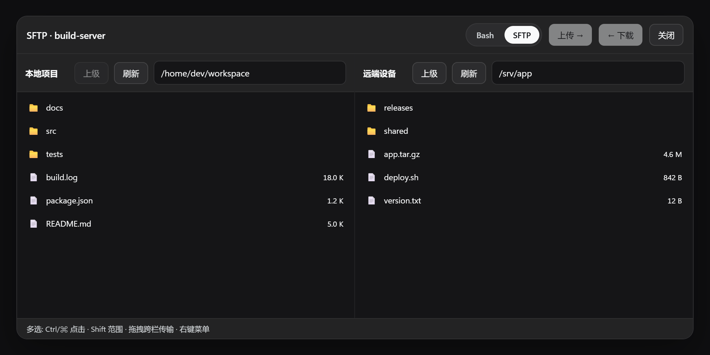
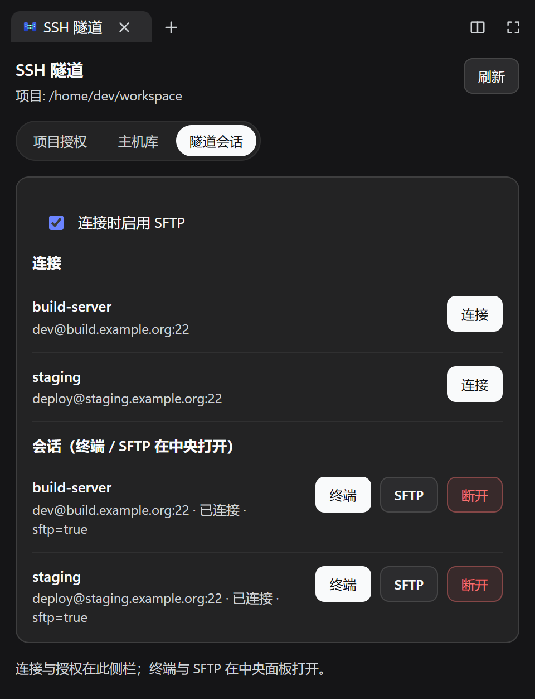

<p align="center"><a href="README.md">简体中文</a> | <strong>English</strong></p>

<div align="center">
<h1><br>DSH SSH Tunnel</h1>

  <p>A multi-host SSH workbench for DeepSeek Harness: host inventory, per-project grants, and a terminal plus dual-pane SFTP in the sidebar.</p>
  <p>The model drives the <strong>SSHManager</strong> tool to run commands and move files; you manage hosts and grants in the sidebar. <strong>Secrets never enter model context</strong>.</p>

  <p>
    <a href="https://www.npmjs.com/package/dsh-ssh-tunnel"></a>
    
    <a href="LICENSE"></a>
    <a href="https://github.com/OMSociety/dsh-ssh-tunnel/stargazers"></a>
    <a href="https://github.com/OMSociety/dsh-ssh-tunnel/issues"></a>
  </p>
<a href="#what-this-is">What this is</a> • <a href="#screenshots">Screenshots</a> • <a href="#installation">Installation</a> • <a href="#sidebar">Sidebar</a> • <a href="#model-tool">Model tool</a> • <a href="#security">Security</a> • <a href="#development">Development</a> • <a href="#license-and-author">License and author</a>
</div>

## What this is

**DSH SSH Tunnel** is a community plugin for DeepSeek Harness, mounted as a tab in the **official DSH right sidebar**. It collects your SSH hosts into one **host inventory**, authorizes them per project, and then opens an **interactive terminal** (xterm) or **dual-pane SFTP** in the center panel.

It does **not** replace the global `fs` / `subprocess` with a remote disk: remote operations happen only in the `SSHManager` tool you call explicitly and inside the panel, and local and remote files remain two clearly separated sides.

Its companion plugin is [dsh-git-forge](https://github.com/OMSociety/dsh-git-forge) (Git credentials and push policy).

## Prior art

**The product shape and several UX patterns are informed by the open-source [LiveAgent](https://github.com/thirsty5034/LiveAgent)** (multi-host SSH inventory, project-scoped access, sidebar tunnel management, center terminal / SFTP surfaces).

## Screenshots

<table>
<tr>
<td width="66%" align="center"></td>
<td width="34%" align="center"></td>
</tr>
<tr>
<td align="center">Center panel: dual-pane SFTP — project workspace on the left, remote on the right, drag across panes</td>
<td align="center">Sidebar: the Sessions page — connect a host, then open the terminal or SFTP in the center</td>
</tr>
</table>

## Installation

**Install from npm**

```powershell
# stop the running DSH first (a live service holds the dependency lock; start it again afterwards)
dsh plugin --profile <profile> add "dsh-ssh-tunnel@1.2.5"
```

> **Note**: After installing, **refresh the browser page** for the "SSH Tunnel" entry to appear in the sidebar — restarting the host alone is not enough, because the client artifact is fetched when the page loads.

**First run**

1. Open the "SSH Tunnel" tab in the sidebar and add a host on the **Hosts** page (password or private key)
2. Switch to **Project access** and grant that host to the current project, then save (without a grant you cannot connect — that is intentional)
3. Back on **Sessions**, press Connect; the first connection asks you to confirm the host key fingerprint
4. Click **Terminal** for an interactive shell, or **SFTP** for the dual-pane panel
5. Have the model run `SSHManager action=exec`, list a directory with `sftp_list`, and move a file with `sftp_upload` / `sftp_download` to verify the whole chain

## Sidebar

One sidebar tab with three pages; the UI follows the DSH interface language between Chinese and English live:

| Page | Purpose |
|---|---|
| **Project access** | Hosts the current project may use; the grant key is the **DSH session workspace** (`projectPathKey`) |
| **Hosts** | Host CRUD and OpenSSH config scan import; password or private key (with passphrase), keys stay host-side |
| **Sessions** | Connect / disconnect, open the terminal or SFTP; dropped sessions stay as tombstones you can reconnect (same id) or close; unexpected drops auto-reconnect up to 3 times, ssh2 keepalive 30s × 3 |

## Model tool

`SSHManager` actions, grouped by purpose:

| Action | Purpose |
|---|---|
| `list_hosts` / `list_sessions` | List the host inventory and the current sessions |
| `create_session` / `close_session` | Open or close a session (together with `session_strategy`) |
| `exec` | Run a remote command (`command`, `cwd`, `timeout_ms`) |
| `sftp_list` / `sftp_stat` / `sftp_read_text` / `sftp_write_text` | Remote listing, metadata and text I/O |
| `sftp_mkdir` / `sftp_rename` / `sftp_delete` | Remote directory creation, rename and delete |
| `sftp_upload` / `sftp_download` | Transfer files between the project workspace and the remote side |
| `read_session` / `send_input` / `resize_session` | Read, feed and resize an interactive session |

- Session strategies: `reuse_or_create` (default; revives a disconnected session for that host), `new`, `require_existing`, or an explicit `session_id`
- Timeouts: exec 30s, SFTP metadata 30s, SFTP transfers 120s, shell operations (`read_session` / `send_input` / `resize_session`) 10s by default; `timeout_ms` overrides them, clamped to 1000–300000, with a 300s ceiling for the whole call
- `max_bytes`: per-call output cap for exec and `sftp_read_text`, clamped to 1024–1048576 bytes (defaults: 262144 = 256 KiB for exec, 524288 = 512 KiB for `sftp_read_text`); when the cap is hit the result sets `truncated: true` and carries only the first `max_bytes` bytes
- exec settlement: results carry `exitKnown` / `code` / `signal` / `connectionDropped` — a normal exit sets `exitKnown: true` with the exit code in `code`; a signal death returns `signal`; a cut connection returns `code: null` with `connectionDropped: true`
- Interactive output is read through a seq cursor protocol (the sidebar polling API `shellRead`): the client sends the last `since` it has seen, and the response returns `chunk` / `since` / `seq` / `baseSeq` / `dropped` / `chunkTruncated`; ring-buffer eviction (512 KiB) moves `baseSeq` forward and sets `dropped: true`, telling the client to refetch in full; a single response caps `chunk` at 256 KiB
- Authentication is **password** or **private key** only; keyboard-interactive (including bastion web MFA) is not supported

## Security

**Trust boundary (stated as it is)**: the plugin's API and vendor routes are served by the DSH host's web server, and the host `connection` service is a required dependency. Every request first passes host admission: when the host provides `connection.requestRejection(req)`, it applies the host's Host/Origin fence and browser-session authentication, a 401 or 403 ends the response immediately with the same status, and only `undefined` proceeds; when the host does not provide it (DSH 0.2.3-alpha.1 and later), the Peer passed by the WebServer must be an owner, otherwise the response is 403. Admitted requests proceed to plugin URL/body parsing, file reads and business dispatch. Session APIs require `projectPathKey` and are invisible across projects.

Authorization and path-guard action list:

- **Grant before connect**: a host that is not checked under Project access cannot be connected, and Connect never auto-writes grants
- **Revocation takes effect immediately**: write operations re-check the grant once before being issued and once before the result is delivered; after a revocation the output is discarded and the call fails with `not authorized`, a local file mid-download is deleted, affected live sessions are closed, and reconnect refuses to resurrect the revoked host
- **Local path guard fails closed**: local upload / download / list / mkdir / delete / rename paths are constrained to the **project workspace root**, with both lexical and realpath checks, and out-of-bounds paths or symlinks pointing outside the workspace are rejected; when no workspace root can be resolved the operation is refused (the environment variable `DSH_SSH_TUNNEL_WORKSPACE_ROOT` can set one explicitly)
- Tool results and list APIs never return password / PEM / passphrase
- Host keys are stored as **SHA256 hex** in `known_hosts.json`; the first connect or a fingerprint change is confirmed in the sidebar with the fingerprint shown
- Prefer key-based auth; rotate credentials immediately if `secrets.json` may have leaked
- Authentication is password or private key

## Where data lives

Under `$DSH_HOME/ssh-tunnel/` (directory mode `0700`; this is POSIX behavior — on Windows NTFS permissions come from inherited ACLs and `chmod` does not change the DACL):

| File | Contents | Mode (POSIX) |
|---|---|---|
| `hosts.json` | Host metadata (no secret material) | `0600` |
| `secrets.json` | Passwords / PEM / passphrases | `0600` |
| `grants.json` | `projectPathKey → hostIds[]` | `0600` |
| `known_hosts.json` | Trusted host key fingerprints | `0600` |

## Development

```sh
npm test                            # full regression of the smoke scripts (runs node scripts/smoke-test.mjs)
npm run check                       # syntax check + smoke tests
node scripts/smoke-test.mjs         # run the smoke scripts directly (offline by design: no SSH, no DSH process)
bash scripts/sync-to-dsh.sh --dry-run                    # preview the link: registration; drop --dry-run to actually rewrite the profile
npm run build:preview               # regenerate the preview images under docs/ (needs local Chrome; CHROME_PATH overrides)
node scripts/portal-probe.mjs       # client tab render probe (runs when react resolves, otherwise skips)
```

Layout and where to change what:

```text
lib/index.js            Host entry: tool registration, /dsh-ssh-tunnel/api routes, grants and path guard, xterm asset serving
lib/client.js           Client bundle (committed; dsh plugin add does not build)
lib/session.js          Session lifecycle: connect, keepalive, drop tombstones and auto-reconnect, exec/SFTP execution
lib/shared/             Pure functions shared by host and client: path / args / host-key / host-summary / http-trust / persist /
                        session-auth / session-policy / shell-buffer / vendor
docs/preview/           Preview input: fixture.json is fictional data; panel.html and docs/panel-*.png are generated by build:preview
scripts/                install.sh · install.ps1 · sync-to-dsh.sh · smoke-test.mjs · portal-probe.mjs
scripts/lib/            Installer shared logic (.cjs, used by both install.sh and install.ps1)
cordis.patch.yml        In-package bundle patch the CLI turns into dsh.profile.bundles
```

### xterm loading

`@xterm/xterm@5.5.0` and `@xterm/addon-fit@0.11.0` are pinned runtime dependencies. The host serves their UMD and CSS from an allowlisted same-origin route (`/dsh-ssh-tunnel/vendor/xterm.js|addon-fit.js|xterm.css`), and the client loads them with plain `<script>` / `<link>` tags. There is no CDN fallback and no module-table requirement.

## Support and credits

- If this plugin helps you, a Star is welcome; questions and suggestions go to [Issues](https://github.com/OMSociety/dsh-ssh-tunnel/issues) or [Pull Requests](https://github.com/OMSociety/dsh-ssh-tunnel/pulls).
- Changes are recorded in the [CHANGELOG](CHANGELOG.md).
- LiveAgent ([thirsty5034/LiveAgent](https://github.com/thirsty5034/LiveAgent)): prior art for the product shape and several UX patterns (see "Prior art" above)
- DeepSeek Harness: the host for plugins, tools and agent shells

## License and author

[MIT](LICENSE). The license terms and copyright are defined by LICENSE; upstream project and code author [@thirsty5034](https://github.com/thirsty5034).
